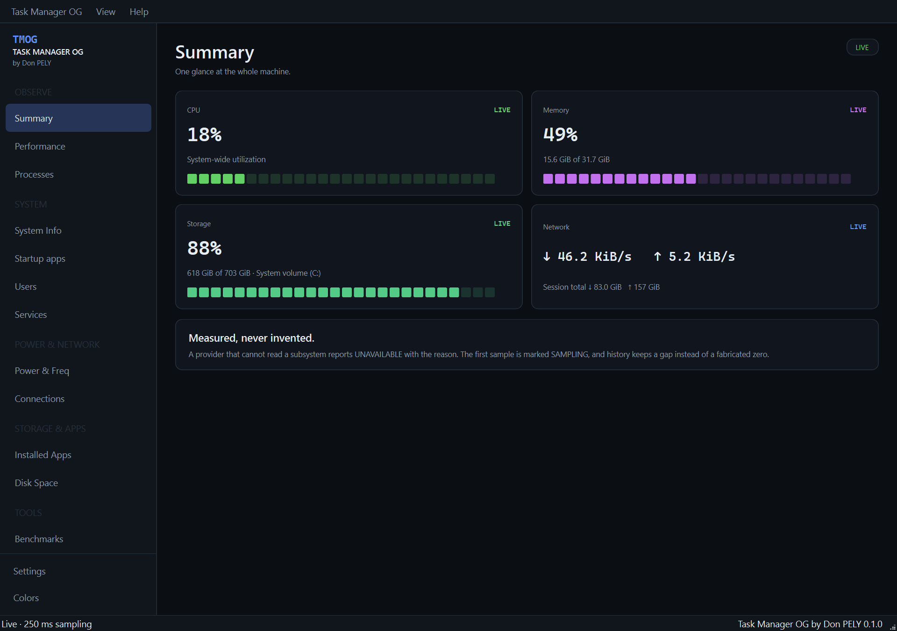

# Task Manager OG by Don PELY

[](https://github.com/yourbossdonpely/tmog-taskmanager/actions/workflows/ci.yml)

**A native, privacy-first task manager for Windows, macOS and Linux.**

Task Manager OG by Don PELY is a ground-up, MIT-licensed re-envisioning of the classic
Task Manager OG idea: one precise instrument that shows what the machine is doing, which
process is responsible, and why it feels slow.

> **Status: pre-alpha.** The application shell builds and passes CI on Windows, macOS and
> Linux; the measurement providers and the first installable release are still in progress.
> Nothing here is installable yet.



*Foundation shell, Windows build. Measurements are intentionally not connected yet.*

---

## Why this project

Most system monitors either drown you in numbers or hide the cause behind a wall of graphs.
This project follows four rules:

1. **Measured, never invented.** A reading is either real, explicitly unavailable, or
   explicitly denied. Missing sensor data is shown as a gap, not a smooth line or a fake zero.
2. **Name the cause.** Every screen should answer “what is responsible?” — not just “what is
   the number?”.
3. **Native all the way down.** C++20 and Qt 6 Widgets. No Electron, no embedded browser,
   no web view, and no background cloud account.
4. **Local by default.** No telemetry, no advertising identifiers, no upload of process or
   hardware data. The app works offline.

## The twelve destinations

| Observe | System | Power & network | Storage & apps | Tools |
| --- | --- | --- | --- | --- |
| Summary | System Info | Power & Freq | Installed Apps | Benchmarks |
| Performance | Startup apps | Connections | Disk Space | Flight Recorder |
| Processes | Users | | | |
| | Services | | | |

Planned capabilities include live CPU, memory, disk, network, GPU, energy and thermal
measurement; a sortable and filterable process tree; identity-safe process actions; startup,
user and service management; socket inspection; installed-app and disk-space analysis;
benchmarks; and a free, documented Flight Recorder for replaying a slowdown.

## Design principles

- **Explicit availability.** Every metric carries a state: available, unsupported, permission
  denied, temporarily unavailable, or error. The UI never substitutes a plausible number.
- **Identity-safe actions.** A process is identified by PID *and* creation time, so a recycled
  PID cannot redirect an end-task or priority change to the wrong program.
- **Keyboard first.** Every destination and action is reachable without a mouse. A command
  palette exposes navigation, filtering and actions.
- **Accessible by construction.** Scalable text, high-contrast support, screen-reader names and
  keyboard access to meters, tables and graphs.
- **No paywall.** All functionality in this repository is free and open source. There is no
  licence server and no Pro gate.
- **Honest gaps.** When a provider stops, the trace stops. History shows the hole.

## Planned platform support

| Platform | Architecture | Packages |
| --- | --- | --- |
| Windows 11 | x64, ARM64 | Inno Setup installer, portable ZIP |
| macOS 14+ | Apple silicon, Intel x64 | Universal `.dmg` (or per-arch if required) |
| Linux | x64, ARM64 | AppImage, `.deb`, `.tar.gz` |

Release artifacts will be published on GitHub Releases with SHA-256 checksums and release
notes. Code signing and macOS notarization will be enabled when the signing identities are
available; unsigned development builds will be labelled as such.

## Build

The application is built with CMake and Qt 6 Widgets. Planned minimums:

- CMake 3.24+
- A C++20 compiler (MSVC 2022, Clang 15+, or GCC 12+)
- Qt 6.10 or newer (Widgets; dynamically linked)

```bash
cmake -S . -B build -DCMAKE_BUILD_TYPE=Release -DCMAKE_PREFIX_PATH=/path/to/Qt/6.x/gcc_64
cmake --build build --config Release
ctest --test-dir build -C Release --output-on-failure
```

On Windows, use the Visual Studio 2022 generator and the matching MSVC Qt kit:

```powershell
cmake -S . -B build -G "Visual Studio 17 2022" -A x64 `
  -DCMAKE_PREFIX_PATH=C:/Qt/6.12.1/msvc2022_64
cmake --build build --config Release
ctest --test-dir build -C Release --output-on-failure
```

Verified locally on Windows with MSVC 2022 and Qt 6.12.1. The CI matrix builds
Windows, macOS and Linux; it is pinned to Qt 6.10.3 until the unattended Qt installer
understands the 6.11+ repository layout. Packaging commands are added in the packaging
milestone. Qt is used under the LGPLv3 and is dynamically linked; see
[NOTICE](docs/NOTICE.md).

## Command line

A console companion is built beside the windowed application:

```bash
tmog-cli --version
```

The planned `--snapshot` and `--self-test` commands will use the same measurement core.

## Documentation

- [Research: the reference application and what we learned](docs/RESEARCH.md)
- [Product and technical design](docs/DESIGN.md)
- [Implementation plan and release checklist](docs/PLAN.md)

## Credits and trademarks

Task Manager OG / TMOG is Dave Plummer's product. This project is **not affiliated with,
sponsored by, or endorsed by** Dave Plummer or Plummers' Software LLC. No upstream source
code, artwork, fonts or other assets are copied or redistributed here. Public screenshots
and product documentation were studied only to understand behaviour and information
architecture.

The project name is used at the owner's direction. If the naming ever creates a conflict,
the product name can be changed without changing the codebase.

## License

[MIT](LICENSE) © 2026 Don Pely.

Qt is a separate dependency under its own licence; see [NOTICE](docs/NOTICE.md).
