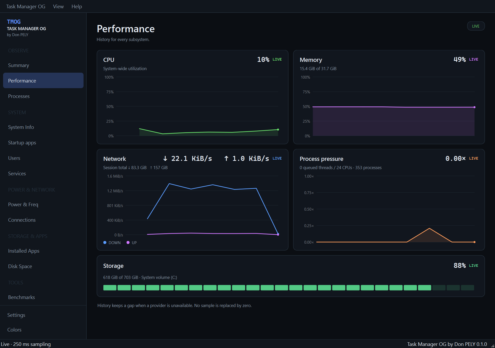
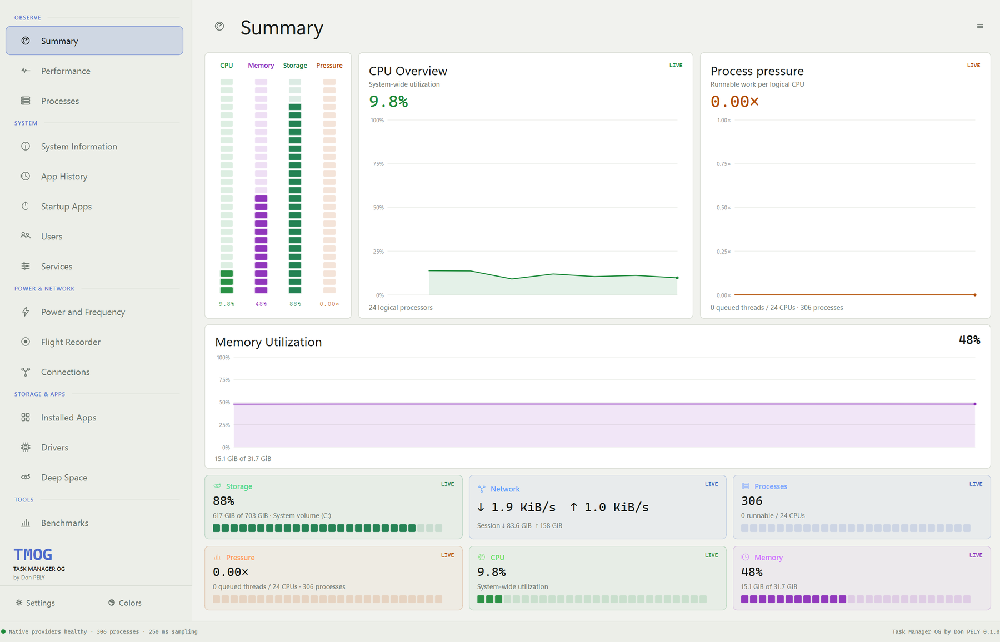

# Task Manager OG by Don PELY

[](https://github.com/yourbossdonpely/tmog-taskmanager/actions/workflows/ci.yml)

**A native, privacy-first task manager for Windows, macOS and Linux.**

Task Manager OG by Don PELY is a ground-up, MIT-licensed re-envisioning of the classic
Task Manager OG idea: one precise instrument that shows what the machine is doing, which
process is responsible, and why it feels slow.

> **Status: pre-alpha.** Live CPU, memory, storage, network and process-pressure readings
> build and pass CI on Windows, macOS and Linux. The first tagged prerelease, **v0.1.0**,
> ships Windows, universal macOS and Linux packages from the [Releases page](https://github.com/yourbossdonpely/tmog-taskmanager/releases/tag/v0.1.0).
> Several destination providers are still module shells.


*Summary on Windows at the measured 1800 × 1156 reference geometry: live gauges, CPU and
process-pressure history, the memory band and the six-card strip. Sampled at 250 ms.*



*Performance: subsystem rail, large selected history, and live snapshot. A missing sample
becomes a gap in the trace, never a zero.*



*Every surface, gauge and chart has a full light-theme treatment, not an inverted graph.*

---

## Why this project

Most system monitors either drown you in numbers or hide the cause behind a wall of graphs.
This project follows four rules:

1. **Measured, never invented.** A reading is either real, explicitly unavailable, or
   explicitly denied. Missing sensor data is shown as a gap, not a smooth line or a fake zero.
2. **Name the cause.** Every screen should answer “what is responsible?” — not just “what is
   the number?”.
3. **Native all the way down.** C++20 and Qt 6 Widgets. No Electron, no embedded browser,
   no web view, and no background cloud account.
4. **Local by default.** No telemetry, no advertising identifiers, no upload of process or
   hardware data. The app works offline.

## The fifteen destinations

The rail order is fixed, and every destination is free:

| Observe | System | Power & network | Storage & apps | Tools |
| --- | --- | --- | --- | --- |
| Summary | System Information | Power and Frequency | Installed Apps | Benchmarks |
| Performance | App History | Flight Recorder | Drivers | |
| Processes | Startup Apps | Connections | Deep Space | |
| | Users | | | |
| | Services | | | |

The rail reads top to bottom: Summary, Performance, Processes, System Information, App
History, Startup Apps, Users, Services, Power and Frequency, Flight Recorder, Connections,
Installed Apps, Drivers, Deep Space, Benchmarks.

There is no Pro divider, no locked row and no paid tier. The shell is measured against the
official TMOG screenshots at 1800 × 1156; see [UI specification](docs/UI_SPEC.md) for the
pixel measurements, type scale and the deliberate differences.

Live CPU, memory, storage, network and process-pressure readings are implemented on all
three platforms. Still planned: per-processor detail, GPU, energy and thermal measurement;
a sortable and filterable process tree; identity-safe process actions; startup, user and
service management; socket inspection; installed-app and disk-space analysis; benchmarks;
and a free, documented Flight Recorder for replaying a slowdown.

## Measurement sources

| Reading | Windows | macOS | Linux |
| --- | --- | --- | --- |
| CPU | `GetSystemTimes` deltas | `host_statistics(HOST_CPU_LOAD_INFO)` deltas | `/proc/stat` deltas |
| Memory | `GlobalMemoryStatusEx` | `hw.memsize` + `host_statistics64` (active, wired and compressed) | `/proc/meminfo` (total − `MemAvailable`) |
| Storage | `GetDiskFreeSpaceEx` for the system volume | `statvfs("/")` | `statvfs("/")` |
| Network | `GetIfTable2`, non-loopback totals | `sysctl NET_RT_IFLIST2`, non-loopback totals | `/proc/net/dev`, non-loopback totals |
| Process pressure | Toolhelp process count + PDH Processor Queue Length | `KERN_PROC_ALL` + `hw.logicalcpu` | `/proc/stat` `procs_running` + `/proc` process count |

Rates are computed from two samples. The first sample is marked `SAMPLING`; a counter reset
produces `UNAVAILABLE` with the reason and a gap in history. Memory and storage values are
system-wide; network rates are summed across non-loopback interfaces. Process pressure is
instantaneous runnable or queued work per logical CPU; the card detail states whether the
source counts runnable threads, queued threads or running processes.

## Design principles

- **Explicit availability.** Every metric carries a state: available, unsupported, permission
  denied, temporarily unavailable, or error. The UI never substitutes a plausible number.
- **Identity-safe actions.** A process is identified by PID *and* creation time, so a recycled
  PID cannot redirect an end-task or priority change to the wrong program.
- **Keyboard first.** Every destination and action is reachable without a mouse. A command
  palette exposes navigation, filtering and actions.
- **Accessible by construction.** Scalable text, high-contrast support, screen-reader names and
  keyboard access to meters, tables and graphs.
- **No paywall.** All functionality in this repository is free and open source. There is no
  licence server and no Pro gate.
- **Honest gaps.** When a provider stops, the trace stops. History shows the hole.

## Download

The [`v0.1.0` prerelease](https://github.com/yourbossdonpely/tmog-taskmanager/releases/tag/v0.1.0)
contains fifteen assets:

| Platform | Packages |
| --- | --- |
| Windows x64 | Inno Setup `.exe`, `.msi`, portable ZIP |
| macOS 14+ universal | `.dmg`, portable ZIP |
| Linux x64 | AppImage, `.deb`, `.rpm`, portable `.tar.gz` |

Every package has a SHA-256 checksum in `SHA256SUMS.txt`. The Windows installers are
self-signed with the included certificate; macOS is ad-hoc signed and **not notarized**;
the Linux checksums and `latest.json` are signed with the included release key. These
signatures establish integrity against the published keys, not identity against a public
certificate authority. The app does not auto-update yet; `latest.json` is the signed
manifest for future updater wiring.

## Build

The application is built with CMake and Qt 6 Widgets. Planned minimums:

- CMake 3.24+
- A C++20 compiler (MSVC 2022, Clang 15+, or GCC 12+)
- Qt 6.10 or newer (Widgets; dynamically linked)

```bash
cmake -S . -B build -DCMAKE_BUILD_TYPE=Release -DCMAKE_PREFIX_PATH=/path/to/Qt/6.x/gcc_64
cmake --build build --config Release
ctest --test-dir build -C Release --output-on-failure
```

On Windows, use the Visual Studio 2022 generator and the matching MSVC Qt kit:

```powershell
cmake -S . -B build -G "Visual Studio 17 2022" -A x64 `
  -DCMAKE_PREFIX_PATH=C:/Qt/6.12.1/msvc2022_64
cmake --build build --config Release
ctest --test-dir build -C Release --output-on-failure
```

Verified locally on Windows with MSVC 2022 and Qt 6.12.1. CI builds Windows, macOS and
Linux against the same official Qt 6.12.1 archives: it reads `Updates.xml`, verifies the
archive SHA-1 files and extracts `qtbase` directly, because the unattended Qt installer
cannot resolve the 6.11+ repository layout. Packaging is implemented in `packaging/` and
driven by `.github/workflows/release.yml`; see the [release runbook](docs/RELEASING.md)
for exact commands, prerequisites, signing limits and verification. Qt is used under the
LGPLv3 and is dynamically linked; see [NOTICE](docs/NOTICE.md).

## Command line

A console companion is built beside the windowed application:

```bash
tmog-cli --version
```

The planned `--snapshot` and `--self-test` commands will use the same measurement core.

## Repository map

- `src/core/` — settings, measurement providers, availability states and parsers.
- `src/ui/` — Qt shell, measured Summary/Performance layouts, themes, icons and pages.
- `tests/` — unit tests for settings, themes, parsing and version identity.
- `packaging/` — Windows Inno/WiX, macOS DMG and Linux package recipes.
- `.github/workflows/ci.yml` — three-platform build/test matrix.
- `.github/workflows/release.yml` — tag-driven packaging and publishing.
- `docs/` — reference research, measured UI spec, design, plan and release runbook.
- `build/`, `dist/` — ignored local build and package output.

## Documentation

- [Research: the reference application and what we learned](docs/RESEARCH.md)
- [UI specification and reference measurements](docs/UI_SPEC.md)
- [Product and technical design](docs/DESIGN.md)
- [Implementation plan and release checklist](docs/PLAN.md)
- [Release runbook: packaging, signing and publishing](docs/RELEASING.md)

## Credits and trademarks

Task Manager OG / TMOG is Dave Plummer's product. This project is **not affiliated with,
sponsored by, or endorsed by** Dave Plummer or Plummers' Software LLC. No upstream source
code, artwork, fonts or other assets are copied or redistributed here. Public screenshots
and product documentation were studied only to understand behaviour and information
architecture.

The project name is used at the owner's direction. If the naming ever creates a conflict,
the product name can be changed without changing the codebase.

## License

[MIT](LICENSE) © 2026 Don Pely.

Qt is a separate dependency under its own licence; see [NOTICE](docs/NOTICE.md).
